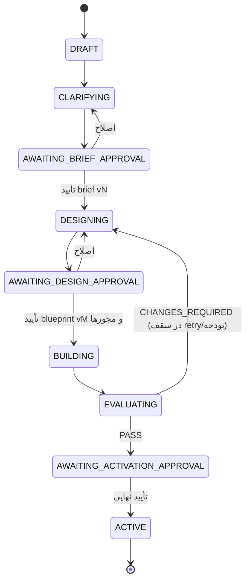
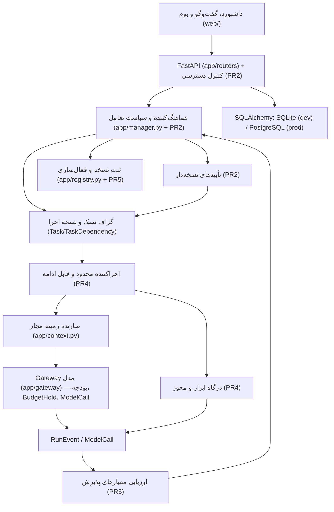
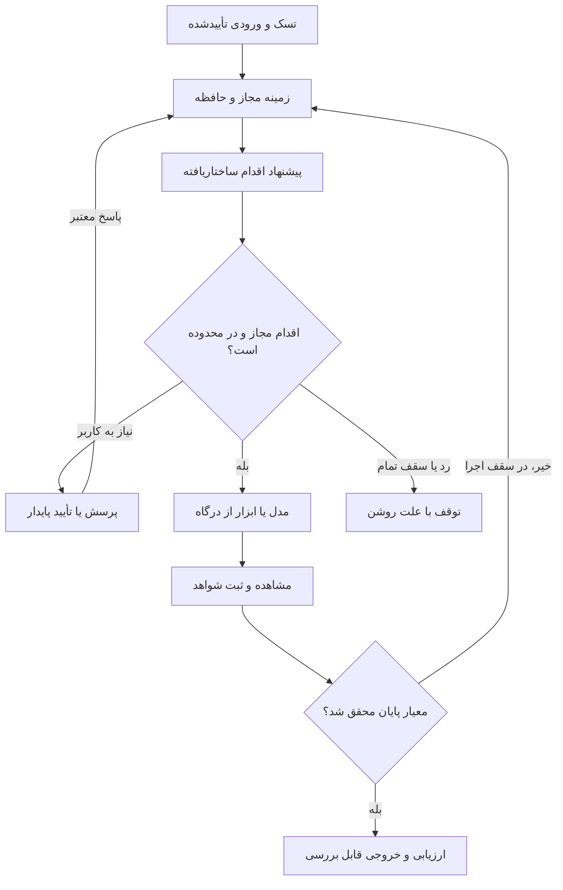

# کارخانه‌ی ایجنت با هدایت کاربر — معماری، قراردادها، وضعیت‌ها و خطاها

> منبع: Issue #2 مخزن («Human-guided Agent Factory»، ۱۱ اکتبر ۲۰۲۶) و تصمیم‌های صاحب پروژه.
> این سند بخش‌های «خودگردانی» `docs/ARCHITECTURE.md` را جایگزین می‌کند؛ استاندارد ۱۴بخشی
> (`docs/AGENT_BLUEPRINT.md`) و شش Engine (`docs/AGENT_PRINCIPLES.md`) بدون تغییر معتبرند.
> هر بخش برچسب دارد: **[پیاده‌شده — PR1]** یعنی در کد هست و تست دارد؛ **[پیشنهادی — PRn]** یعنی طراحی است و
> هنوز کدی برایش نوشته نشده. ادعای «پیاده‌شده» فقط با ارجاع به فایل و تست.

---

## ۱. هدف و اصل‌ها

کاربری که برنامه‌نویس نیست بتواند مسئله را مطرح کند، برداشت سیستم را اصلاح کند، طرح را تأیید کند و یک ایجنت آزموده
و قابل‌اتصال تحویل بگیرد. کاربر توسعه‌دهنده همین مسیر را با جزئیات کد، schema و تست می‌بیند.

اصل‌ها (جایگزین «Automatic Mode = حداقل دخالت کاربر» در ARCHITECTURE §0، §2.1، §36):

1. **همه‌ی حالت‌ها تعاملی‌اند.** هیچ حالتی «بدون کاربر» نیست؛ فرق حالت‌ها فقط در *تعداد* نقاط تأیید است.
2. **مدل پیشنهاد می‌دهد، کد تصمیم می‌گیرد.** کدام فیلد اجباری است، کدام مرحله مجاز است، کدام تأیید معتبر است —
   همه کد قطعی‌اند. خروجی مدل schema-validated است و از Gateway رد می‌شود.
3. **سکوت تأیید نیست.** عدم پاسخ، timeout یا پاسخ دیررس هیچ‌وقت چیزی را تأیید نمی‌کند.
4. **دیدن بیشتر ≠ اجازه‌ی بیشتر.** سطح توضیح، زبان و نمایش کد هیچ مجوز، بودجه یا اختیاری اضافه نمی‌کند.
5. **حدس با داده‌ی کاربر قاطی نمی‌شود.** هر داده وضعیت `draft / proposed / confirmed` و منبع دارد.
6. **ارتباط فقط از orchestrator.** هیچ تماس آزاد agent-to-agent؛ اتصال ظاهری روی بوم مجوز اجرا نیست (§53).

---

## ۲. چهار محور مستقل تنظیمات **[پیاده‌شده — PR1]**

| محور | مقادیر | کجا ذخیره می‌شود | چه چیزی را عوض می‌کند | چه چیزی را عوض **نمی‌کند** |
|---|---|---|---|---|
| `ui_locale` | `fa` / `en` / `tr` | حساب کاربر (`user_preferences`)؛ مهمان: فقط `localStorage` | زبان کل UI، سؤال‌های مصاحبه، خطاها، اعلان‌ها؛ جهت صفحه (fa=RTL) | پاسخ‌ها، تأییدها، مرحله؛ متن خود کاربر (ترجمه نمی‌شود) |
| `audience_level` | `ordinary` / `professional` / `developer` | حساب کاربر | عمق توضیح و فیلدهای نمایشی | نیاز، قرارداد، approval، policy، مجوز |
| `code_visibility` | `hidden` / `visible` (خالی = طبق سطح) | حساب کاربر | نمایش کد/JSON/جزئیات فنی | توضیح دلیل (همیشه نشان داده می‌شود) |
| `interaction_policy` | `step_by_step` / `milestone` / `delegated_bounded` | لایه‌های تنظیمات | تعداد نقاط تأیید | مجوز ابزار، بودجه، سقف تکرار |
| `quality_target` | `prototype` / `production_candidate` | لایه‌های تنظیمات | عمق ارزیابی (PR5) | اختیار |
| `output_locale` | `auto` / `fa` / `en` / `tr` | لایه‌های تنظیمات | زبان پاسخ مدل‌ها | متن کاربر |

جزئیات اجرا:

- **پیش‌فرض‌ها پیشنهادند، نه انتخاب کاربر.** `ui_locale` و `audience_level` تا وقتی کاربر انتخاب نکرده `null`
  می‌مانند؛ API مقدار مؤثر را جدا در `effective` برمی‌گرداند (`app/preferences.py::effective`). UI در اولین ورود
  زبان را می‌پرسد و سطح پیشنهادی را با دکمه‌ی «تأیید همین سطح» به تأیید کاربر می‌گذارد.
- **API:** `GET /users/{id}/preferences`، `PATCH /users/{id}/preferences` (فقط کلیدهای ارسال‌شده؛ `null` فقط برای
  `code_visibility` = «طبق سطح»). مقدار ذخیره‌شده‌ای که این نسخه دیگر ارائه نمی‌دهد «انتخاب‌نشده» خوانده می‌شود.
- **زبان پاسخ مدل:** `output_locale=auto` یعنی زبانی که مالک برای UI انتخاب کرده؛ اگر انتخاب نکرده، هیچ دستور زبانی
  به مدل داده نمی‌شود (پیش‌فرض فارسی UI پاسخِ کاربر نیست). یک خط `Reply language: …` به محتوای کاربر در plan،
  chat و اجرای task اضافه می‌شود — نه به system prompt، تا cache پایدار بماند (`app/preferences.py::reply_language_line`).
- **تست‌ها:** `tests/test_preferences.py`، `tests/test_interaction_policy.py`، `tests/test_i18n.py`، `tests/test_interview.py`.

### ۲.۱ سیاست تعامل و سقف آن

ترتیب سخت‌گیری: `step_by_step` < `milestone` < `delegated_bounded`.

- `step_by_step`: هر مرحله تأیید می‌خواهد. **پیش‌فرض ساخت ایجنت** (`FACTORY_DEFAULT_POLICY`).
- `milestone`: فقط نقاط اصلی (تأیید برنامه، تأیید طرح، فعال‌سازی) تأیید می‌خواهند.
- `delegated_bounded`: اقدامات مجاز *داخل دامنه‌ی تأییدشده* انجام می‌شوند؛ در ابهام یا تغییر دامنه توقف و سؤال.

`max_interaction_policy` سقف شل‌ترین سیاست مجاز در آن لایه و پایین‌تر است: `resolve()` سخت‌گیرانه‌ترین سقفِ همه‌ی
لایه‌ها را برمی‌دارد، پس پروژه یا task نمی‌تواند محدودیت سراسری را باز کند («policy لایه پایین مجوز محدودکننده لایه
بالاتر را دور نزند»). مقدار ناشناخته یا خراب = `step_by_step` (fail closed). کد: `app/settings_layers.py::resolve`،
`strictest`.

### ۲.۲ نگاشت حالت‌های قدیمی (سازگاری)

نام‌های `automatic` و `manual_learning` حفظ شده‌اند (API، DB، UI). نگاشت بدون افزایش هیچ اختیاری:

| حالت قدیمی | سیاست پیش‌فرض | سقف | رفتار قبلی که دقیقاً حفظ شد |
|---|---|---|---|
| `manual_learning` | `step_by_step` | `step_by_step` (هیچ لایه‌ای نمی‌تواند شلش کند) | مالک همه‌ی checkpointها را تصمیم می‌گیرد؛ Learning Trace ثبت می‌شود |
| `automatic` | `milestone` | `delegated_bounded` | مالک برنامه را تأیید می‌کند؛ مدیر فقط checkpointهایی را تصمیم می‌گیرد که قاعده‌ی approvals آن ریسک `auto`/`manager` باشد؛ ریسک بالا همیشه با مالک |

محدودیت نگاشت: در PR1 سیاست فقط روی تصمیم خودکار checkpoint اثر دارد (`app/manager.py::create_checkpoint`:
خودکار فقط اگر mode=`automatic` **و** سیاست ≠ `step_by_step` **و** قاعده‌ی ریسک مجاز باشد). تفاوت `milestone` و
`delegated_bounded` با runtime محدود (PR4) معنا پیدا می‌کند؛ تا آن موقع هر دو همان رفتار automatic قبلی‌اند.
شل‌کردن یک پروژه‌ی manual_learning یعنی عوض‌کردن صریح mode، نه یک لایه‌ی تنظیمات.

---

## ۳. قرارداد خطا **[پیاده‌شده — PR1]**

هر پاسخ خطای API: `{"detail": <متن انگلیسی برای لاگ/توسعه‌دهنده>, "code": <کد پایدار>, "params": {...}}`
(`app/errors.py`، handlerها در `app/main.py`). UI متن را از `err.<code>` به زبان کاربر می‌سازد
(`web/i18n.js`)؛ برای کدهایی که دلیل را در `detail` دارند (فیلد نامعتبر، رد مدیر، خطای ارائه‌دهنده) دلیل همیشه
پشت متن محلی می‌آید — مخفی‌کردن کد، توضیح دلیل را حذف نمی‌کند.

| code | HTTP | معنی |
|---|---|---|
| `not_found` | 404 | `params.resource` ∈ project, task, user, workspace, agent, skill, benchmark_run, global |
| `invalid_request` | 422 | ورودی نامعتبر (از جمله خطای اعتبارسنجی FastAPI؛ `detail` همان لیست `{loc,msg}`) |
| `settings_invalid` | 422 | لایه‌ی تنظیمات نامعتبر؛ `detail` هر کلید غلط را نام می‌برد |
| `unknown_dependencies` | 422 | `params.task_ids` |
| `agent_invalid` | 422 | تعریف ایجنت رد شد |
| `request_refused` | 422 | مدیر کار را انجام نداد (برنامه/خروجی نامعتبر، ایجنت ثبت‌نشده) |
| `email_taken` | 409 | |
| `transition_refused` | 409 | ماشین وضعیت این حرکت را مجاز نمی‌داند |
| `project_paused` | 409 | پروژه متوقف است (تصمیم d16) |
| `budget_exceeded` | 402 | |
| `provider_unavailable` | 502 | مدل/ارائه‌دهنده در دسترس نیست |
| `conflict` / `bad_request` / `error` | 409 / 400 / سایر | خطای بدون کد اختصاصی |

یک کد قرارداد است: تغییر نام آن UI را به `detail` برمی‌گرداند. `tests/test_error_codes.py` تضمین می‌کند هر کدی
که backend می‌فرستد در هر سه زبان متن دارد.

---

## ۴. قرارداد داده‌ی مشترک **[پیاده‌شده برای brief — PR2؛ handoff — PR4]**

هر مرحله یک پرونده (brief) با این فیلدها دریافت می‌کند:
`brief_id, brief_version, goal, problem, target_user, input_examples, expected_outputs, acceptance_criteria,
constraints, allowed_sources, unknowns, assumptions, audience_level, interaction_policy, quality_target,
permissions, budget, stage, approved_sections`.

هر داده‌ی جمع‌آوری‌شده: `{value, status: draft|proposed|confirmed, source_ref, revision, confirmed_by?, confirmed_at?}`.

هر handoff (همیشه از orchestrator):
`{stage, input_version, confirmed_inputs, unresolved_questions, proposed_output, evidence, acceptance_results,
next_role, approval_required}`. نقش بعد فقط نسخه‌ی تأییدشده را می‌خواند؛ با اطلاعات حیاتی ناقص، درخواست تکمیل می‌دهد.

نقش‌ها و داده‌ی هرکدام (نقش ≠ ایجنت جدید؛ می‌تواند skill/قابلیت ایجنت موجود باشد):

| نقش UI | نگاشت به موجود | خروجی و شرط عبور |
|---|---|---|
| راهنما (Intake/Manager) | `manager` + skill `agent-intake` | brief تأییدشده و پرسش‌های باز |
| پژوهشگر | `researcher` | شواهد با منبع و FACT/INFERENCE/HYPOTHESIS (گارد شواهد موجود: `_apply_evidence_guard`) |
| مشتری | `customer` | نیازها و سناریوها؛ شبیه‌سازی برچسب «شبیه‌سازی» دارد |
| استراتژی | `strategy` | مسیر، trade-off و فرض‌ها؛ تأیید مسیر |
| طراح (Product/Designer) | `product` | Blueprint ۱۴بخشی، قرارداد I/O، سیاست تعامل، تست‌پلن |
| سازنده (Builder) | **وجود ندارد** (فاز ۶) | تغییرات محدود، تست، PR؛ بدون merge/deploy ضمنی |
| ارزیاب (Reviewer/Evaluator) | **وجود ندارد** | `PASS / CHANGES_REQUIRED / BLOCKED` با شواهد |
| ثبت/انتشار | `app/registry.py` (بدون نسخه/فعال‌سازی) | نسخه‌ی ثبت‌شده و فعال‌سازی قابل‌بازگشت |
| Persona (فقط شبیه‌ساز کاربر) | Blueprint با `agent_type=persona` | شش Engine کامل؛ خروجی برچسب شبیه‌سازی |

---

## ۵. چرخه‌ی ساخت و وضعیت‌ها **[پیشنهادی — PR2..PR5]**

`PAUSED`، `BLOCKED` (با علت: missing_specialist، budget_exhausted، stale_approval، schema_mismatch، permission_denied)،
`FAILED` و `CANCELLED` از هر وضعیت غیرنهایی در دسترس‌اند. این lifecycle **ساخت ایجنت** است و جایگزین ماشین وضعیت
Task (`app/state_machine.py`) نمی‌شود؛ Task منتظر کاربر از `WAITING` + `reason` استفاده می‌کند (PR4).

قواعد پایدار:
- مصاحبه، پاسخ‌ها و checkpointها در DB؛ بعد از refresh/restart از همان سؤال ادامه.
- ویرایش ورودی تأییدشده → revision جدید؛ فقط approvals و مراحل *وابسته* باطل؛ کارهای متأثر متوقف. خروجی درحال‌اجرا
  برای نسخه‌ی قدیمی قابل فعال‌سازی نیست.
- تأیید = `{actor, resource, version, stage, action_scope, decided_at, request_id}`؛ پاسخ دیررس/تکراری/نسخه‌ی قدیمی رد
  (409 با اطلاعات reload/compare)؛ submit و activate idempotent (`request_id`).
- updateها با `expected_revision` (optimistic concurrency).
- متخصص ناموجود: Task و همه‌ی وابستگی‌هایش در DAG می‌مانند و `BLOCKED/WAITING_SPECIALIST` می‌شوند؛ وابستگی حذف نمی‌شود.
  (امروز این قاعده **نقض می‌شود** — جدول gap، ردیف G7.)

---

## ۶. معماری اجزا **[ترکیب موجود + پیشنهادی]**

- UI فقط intent می‌فرستد؛ مجوز، تأیید و تغییر state در backend.
- Gateway تنها مسیر مدل و بودجه است (موجود)؛ سیاست توقف (`app/pause.py`، d16) به همه‌ی مسیرهای جدید هم اعمال می‌شود.
- برای V1 سرویس جدا، vector DB یا framework ارکستریشن اضافه نمی‌شود (§53).

### ۶.۱ چرخه‌ی داخل ایجنت **[پیشنهادی — PR4]**

سقف step/retry/زمان/token/هزینه در `RunSnapshot`؛ در انتظار کاربر worker و transaction باز نمی‌ماند (همان قاعده‌ی d19
برای فراخوانی مدل)؛ محتوای ابزار/منبع دستور دارای اختیار نیست؛ exactly-once عمومی ادعا نمی‌شود — idempotency per-tool.

---

## ۷. مدل داده **[پیشنهادی — جدول‌های موجود اول بررسی شدند]**

| موجودیت | وضعیت امروز | تصمیم |
|---|---|---|
| UserPreference | **ساخته شد (PR1)**: `user_preferences` | جدول جدا (نه ستون روی `users`): `create_all` آن را می‌سازد و جدول موجود مهاجرت لازم ندارد |
| FactorySession, BriefRevision, Approval | ندارد (approvals امروز RunEventهای `decision.*` بدون نسخه/actor‌اند) | PR2 |
| BlueprintRevision | ندارد (Blueprint فقط در مرورگر ساخته و validate می‌شود) | PR3 |
| AgentVersion | `Agent.version` عدد است، تاریخچه ندارد؛ `POST /agents` بلافاصله فعال می‌کند | PR5 |
| CanvasRevision, WorkflowVersion | ندارد | PR6 |
| RunSnapshot, ToolExecution | ندارد | PR4 |
| EvaluationReport | ندارد (`BenchmarkRun` فقط مقایسه‌ی مسیر مدل است) | PR5 |

مهاجرت: امروز `create_all` + `ensure_indexes` + `ensure_column_lengths` (فقط جدول/ایندکس جدید و عریض‌کردن ستون).
افزودن ستون به جدول موجود (مثلاً `Task.reason`) با این الگو ممکن نیست → تصمیم مهاجرت قبل از PR2 لازم است (پیشنهاد:
Alembic با تست SQLite و PostgreSQL واقعی؛ دستور کار در `FACTORY_IMPLEMENTATION_PLAN.md`).

---

## ۸. اتصال‌ها، کلیدها و API بیرونی **[پیشنهادی — PR6/PR7]**

چهار نوع edge: `data` (output schema → input schema با mapping صریح)، `model` (model_role → پیکربندی Gateway)،
`tool` (ابزار → ایجنت فقط با capability و permission واقعی)، `knowledge` (منبع مجاز → context با provenance).
اتصال ظاهری مجوز اجرا نمی‌دهد؛ backend نوع/schema، فیلد الزامی، namespace پروژه و مالکیت، مجوز و چرخه‌ی DAG را
validate می‌کند. Save طراحی از Run جداست. کلید API هرگز در گره، Blueprint، log، export یا متن مدل نمی‌آید — فقط
`credential_ref` سمت سرور. اجرای «حساب Claude خود مالک» (`claude_account`) معادل مدل میزبانی‌شده برای کاربران دیگر
نیست.

---

## ۹. تصمیم‌های این مرحله (Decision → Reason → Trade-off → Result)

1. **ترجیح‌ها جدا از تنظیمات.** زبان/سطح/نمایش کد به حساب کاربر تعلق دارند، سیاست و کیفیت به scope کار. → دلیل: محور
   نمایشی نباید از لایه‌ها اختیار بگیرد یا بدهد. → هزینه: دو API جدا. → نتیجه: `user_preferences` + کلیدهای جدید لایه.
2. **سیاست تعامل از mode مشتق می‌شود مگر صریحاً تنظیم شود.** → دلیل: پروژه‌های موجود نباید بی‌صدا رفتارشان عوض شود. →
   هزینه: دو مفهوم هم‌پوشان تا حذف mode. → نتیجه: نگاشت §۲.۲، تست `test_automatic_project_keeps_its_auto_decisions…`.
3. **سقف به‌جای «لایه‌ی پایین برنده».** → دلیل: Issue صریحاً می‌خواهد لایه‌ی پایین محدودیت بالا را دور نزند. → هزینه:
   کلید دوم (`max_interaction_policy`). → نتیجه: `strictest()`، fail-closed.
4. **کد خطا کنار `detail`، نه به‌جای آن.** → دلیل: کلاینت‌ها و تست‌های موجود `detail` را می‌خوانند. → نتیجه: سازگار.
5. **ترجمه‌ی key-based در یک فایل JS بدون build.** → دلیل: stack فعلی UI بدون bundler است؛ framework عوض نشود. →
   نتیجه: `web/i18n.js` (۳۱۲ کلید × ۳ زبان)، fallback انگلیسی، تست پوشش کامل.

---

## ۱۰. ورود و کنترل دسترسی **[پیاده‌شده — PR2a]** (تصمیم d33)

- **بدون رمز.** اولین بازدیدکننده‌ی سرور اولین حساب (مدیر سرور) را می‌گیرد؛ حساب‌های بعدی را فقط مدیر می‌سازد و با یک
  **کد ورود یک‌بارمصرف** تحویل می‌دهد (۱۰ دقیقه، یک بار، ~۵۹ بیت تصادفی) — دسترسی مدل سرور (اشتراک یا کلید مالک) به
  روی غریبه‌ها باز نمی‌شود.
- **نشست:** توکن تصادفی در کوکی HttpOnly و SameSite=Strict (اسکریپت صفحه آن را نمی‌بیند؛ درخواست سایت دیگر آن را
  نمی‌فرستد ← CSRF ندارد)؛ در DB فقط SHA-256 آن. خروج نشست را باطل می‌کند؛ انقضا ۹۰ روز.
- **حساب‌های قبل از ورود:** migration 0002 همه را «قابل برداشت» می‌کند و اولی را مدیر و مالک workspaceهای قبلی.
  برداشت یک‌باره (`POST /auth/claim`) از همان دستگاه سرور خودکار است (مرورگر قبلی شناسه‌اش را دارد)؛ پشت proxy یا از
  دستگاه دیگر فقط با `AGENT_FACTORY_OWNER_TOKEN`.
- **جداسازی:** هر حساب فقط پروژه، تسک، workspace، لایه‌ی تنظیمات، حافظه، چت، بازخورد و ترجیح‌های خودش را می‌بیند؛
  شناسه‌ی حساب دیگر همان ۴۰۴ «پیدا نشد» است. مدیر هم داده‌ی دیگران را نمی‌بیند؛ فقط چیزهای مشترک را عوض می‌کند: لایه‌ی
  تنظیمات سراسری، registry ایجنت‌ها، سنجش، ساخت حساب.
- **actor واقعی:** از این به بعد هر تأیید (PR2) به حساب واردشده بسته می‌شود، نه به شناسه‌ای که مرورگر ادعا کند.
- **کدهای خطا:** `unauthenticated` (401)، `forbidden` (403، `params.reason`)، `login_code_invalid` (401).

---

## ۱۱. مصاحبه‌ی تطبیقی و brief نسخه‌دار **[پیاده‌شده — PR2]** (تصمیم d28)

- **مسیر:** «+ ایجنت جدید» یک ساخت (`FactorySession`) باز می‌کند. اول یک جمله («چه، برای چه کسی، چه کاری؟») و بعد پنج
  سؤال کوتاه (مخاطب، مسئله، نمونه‌ی ورودی واقعی، خروجی مورد انتظار، یک معیار قابل سنجش)؛ هر نوبت یک سؤال. محدودیت‌ها،
  منابع، مجوزها و بودجه «پیشنهاد» می‌شوند. سؤال‌ها در `registry/factory/brief.yaml` (سه‌زبانه؛ توضیح به سطح کاربر).
- **قطعی، بدون مدل:** ترتیب، کامل بودن، ابهام (جواب خالی/مبهم دوباره پرسیده می‌شود) و تناقض (وب ذکر شده ولی اینترنت
  ممنوع ← سؤال بعدی) همه کد است. دستیار مدل (استخراج از جمله‌ی اول) به PR3 رفت، همراه بودجه‌ی مخصوص هر ساخت — چون
  Gateway امروز فراخوانی بیرون از پروژه را بودجه‌چک نمی‌کند.
- **نسخه‌ها:** هر تغییر یک `BriefRevision` جدید و تغییرناپذیر؛ هر فیلد `{value, status, source, revision}`.
- **تأیید:** به یک نسخه‌ی دقیق بسته است و در نسخه‌ی بعدی همه را confirmed می‌کند؛ `Approval` با actor واقعی (PR2a).
  ویرایش بعد از تأیید ← تأیید باطل (`brief_changed`) و برگشت به مرحله‌ی تأیید. سکوت چیزی را تأیید نمی‌کند.
- **رقابت و تکرار:** هر تغییر `expected_revision` دارد (تب دوم/جواب دیررس ← 409 `stale_revision`) و `request_id`
  (دوبار زدن یک بار اعمال می‌شود). قفل ردیف روی PostgreSQL. توقف/ادامه/لغو؛ هر تغییر یک RunEvent با actor.
- **وضعیت‌ها:** DRAFT → CLARIFYING → AWAITING_BRIEF_APPROVAL → DESIGNING (طراحی Blueprint در PR3) + PAUSED / CANCELLED.

---

## ۱۲. طراحی Blueprint و بوم ساخت **[پیاده‌شده — PR3]**

- **پیش‌نویس قطعی و رایگان:** تأیید برداشت یک Blueprint ۱۴بخشی می‌سازد (`app/design.py::draft_from_brief`). آنچه از کاربر
  عمومی پرسیده نمی‌شود (نقش مدل، ذخیره‌سازی، اجرا، ثبت رویدادها) طبق استاندارد پر و با دلیل نشان داده می‌شود.
- **هشت شاخه‌ی بوم** همه‌ی ۱۴ بخش را پوشش می‌دهند (`BRANCHES`)؛ وضعیت هر شاخه: پیشنهادی / تأییدشده / ناقص.
  ویرایش ← `BlueprintRevision` جدید و تغییرناپذیر و برگشت شاخه به پیشنهادی؛ «برگشت» نسخه‌ی قبلی را به‌صورت نسخه‌ی جدید
  برمی‌گرداند. شاخه‌ی دارای ایراد تأیید نمی‌شود.
- **قواعد قطعی:** همه‌ی مجوزها پیش‌فرض خاموش؛ هر ابزار مجوز خودش را می‌خواهد؛ approval_gate نمی‌تواند از سیاست تعامل
  ساخت شل‌تر باشد (step_by_step ← فقط always).
- **کمک مدل («بهبود با هوش مصنوعی»):** تنها فراخوانی پولی یک ساخت، فقط به درخواست مالک، نقش `cheap`، پاسخ schema-validated،
  پیش از اجرا در برابر بودجه‌ی خود ساخت رزرو می‌شود (`FactorySession.budget_usd` از `budget.task_usd`؛ قفل ردیف ساخت؛
  ۴۰۲ اگر بیشتر شود؛ `ModelCall.factory_session_id`). نتیجه فقط پیشنهاد است. اگر ساخت در حین فراخوانی تغییر کند، نتیجه
  فقط ثبت می‌شود (`design.assist_discarded`) و اعمال نمی‌شود (۴۰۹). این همان شکافی است که PR2 گزارش کرد: فراخوانی بیرون
  از پروژه حالا بودجه‌چک می‌شود.
- **تأیید طرح و مجوزها** به نسخه‌ی دقیق و برداشتِ هم‌اکنون تأییدشده بسته است و ساخت را به BUILDING می‌برد (PR5). تغییر
  برداشت بعد از آن هر دو تأیید را باطل و طرح را از نو می‌کشد (نسخه‌های قبلی در تاریخچه می‌مانند).
- **ظاهر:** پیش‌فرض تم A (روشن)، تم تیره‌ی قبلی انتخابی در تنظیمات (تصمیم d35). بوم: zoom/pan/fit، کیبورد (هر گره دکمه‌ی
  قابل فوکوس)، وضعیت با آیکون و متن، موبایل فهرست مرحله‌ای بدون drag.
